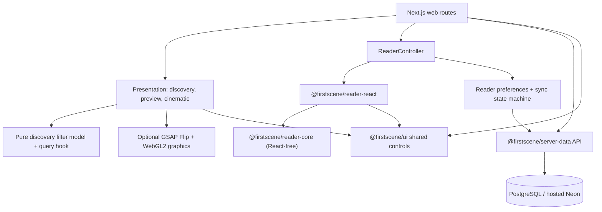

# FirstScene — Cinematic Reading & Creative Frontend

**AI-native Product Design / Creative Frontend engineering portfolio.**

[Live demo](https://firstscene-one.vercel.app/) · [Architecture & design decisions](docs/public/architecture-and-decisions.md) · [Implementation case study](docs/public/portfolio-case-study.md) · [Quality and release evidence](RELEASE_REPORT.md)

FirstScene combines a functional reading application with a deliberately expressive,
optional cinematic showcase. It is a portfolio rather than an attempt to fill a
commercial novel catalog: **two complete stories** can actually be read, while
**34 additional concepts** are explicitly marked unpublished.

## Experience and intent

| Area | Demonstration | Safety / fallback |
| --- | --- | --- |
| Cinematic introduction | Three scene narratives, scrubbed GSAP transitions and an optional WebGL2 shader portal | Semantic HTML, working links, normal-flow layout on touch devices and with motion reduction |
| Story exploration | Search, status/genre/mood filters, preview covers and animated GSAP Flip layout transitions | URL state restoration, keyboard controls, no-JS server-rendered catalog |
| Reader | Two original stories, each with 6 scenes and 36 paragraphs; plain and cinematic modes | Accessible text independent of JS/DB, motion reduction, reading position restoration |
| Reading history | Anonymous progress, saved stories, saved sentences, preferences and explicit completion | Offline queue, conflict handling, deletion and expiry states; no cross-device identity |
| UI foundations | Shared typography/colors, reusable components, mobile-first corrections | Explicit package boundaries, focus/keyboard semantics, 320px regression coverage |

The collection is intentionally not represented as 36 finished manuscripts.
Unpublished preview metadata and SVG covers are static files—not Neon rows or
bucket uploads—and cannot be opened as reader manuscripts.

## Architecture at a glance



`@firstscene/reader-core` remains independent of React, Next.js and GSAP.
Graphics and UI motion do not own persistence or reader content. The sync
state machine owns writes, retries, reset epochs and record deletion; pure
read-only projections are kept separately. Imports and package boundaries
are checked in CI.

**Important code directories:** `apps/web/components`,
`apps/web/lib/graphics`, `apps/web/features/reading-sync`,
`packages/reader-core`, `packages/reader-react`, `packages/ui`,
`packages/server-data`, `contracts/package-boundaries.json`.

## Design and AI-native development workflow

Requirements, UX constraints and acceptance criteria are defined before agent
implementation. AI coding tools were used to implement and revise the code,
while the project owner selected trade-offs, reviewed failures and required
repeatable regression evidence. The repository keeps the actual decisions and
their consequences rather than presenting model-generated output as
automatically correct.

Examples with inspectable code and tests:

- Preview card and query-model separation, including the ready/unpublished filter invariant
- WebGL2 fragment shader using bounded DPR, a reduced computational pass,
  a frame cap and explicit GPU cleanup
- Lazy GSAP Flip import and progressive enhancement around native DOM cards
- Mobile layout repair after a visual mismatch between cover art and copy
- A real PostgreSQL-backed sync protocol with revision checks and idempotent
  requests, plus recorded regression tests

See the [case study](docs/public/portfolio-case-study.md) and
[creative showcase ADR](docs/public/adr-creative-showcase-2026-11.md)
for rejected alternatives, evidence and known constraints.

## Run locally

Prerequisites: **Node.js 24, pnpm 10, Docker**.

```sh
pnpm install --frozen-lockfile
pnpm db:up
pnpm db:migrate
pnpm build
node tools/start-web.mjs --port 3100
```

Open `http://127.0.0.1:3100`. Use only the project's disposable local
database; never commit `.env.local` or private source assets.
[Local operations and recovery instructions](docs/public/runbook.md).

## Quality and honest limitations

```sh
pnpm lint
pnpm typecheck
pnpm check:boundaries
pnpm check:ci
```

The GitHub Actions pipeline additionally exercises real temporary PostgreSQL,
Chromium/WebKit E2E, accessibility, Storybook/package consumption, security
negatives, asset hashes, performance and visual capture, and container smoke.
[Verification record](RELEASE_REPORT.md) differentiates successful automated
checks from manual release/UX review.

- Animated graphics are **optional showcase functionality**: neither the
  reader nor its save protocol requires WebGL.
- Lab performance budgets are not production-user FPS measurements.
- Anonymous sessions do not synchronize reading history across devices.
- Human usability interviews and physical-device visual QA are **not claimed
  as complete**. A successful Vercel deployment is not equivalent to full
  production-release certification.

This repository is a showcase of a complete, inspectable engineering workflow,
including explicit limits and failure recovery—not evidence of unmeasured
commercial usage or product-market fit.
