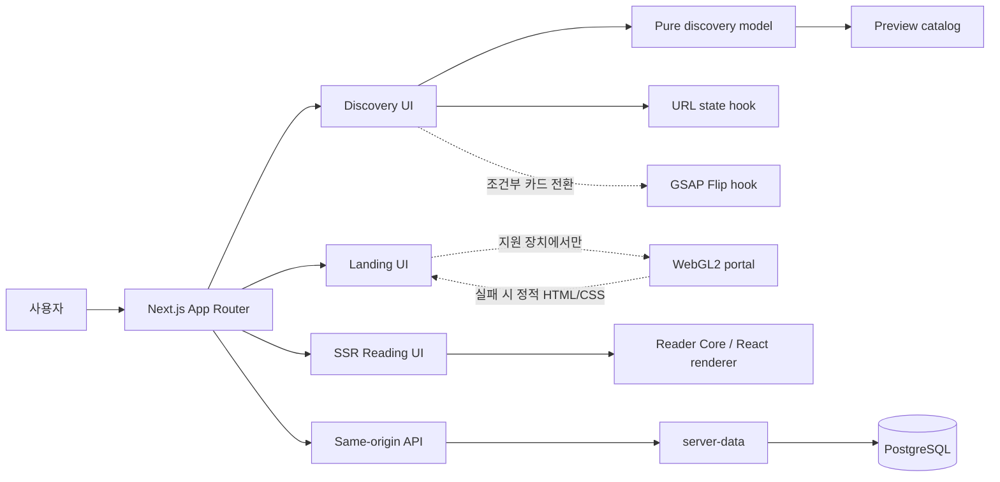

# FirstScene 아키텍처와 검증 경계

`apps/web`은 Next App Router와 동일 Origin API를 제공합니다. 공개 본문은 컴파일된JSON에서 렌더링하며 DB 인증과 분리됩니다. 요청별 nonce CSP를 사용하고 HTML은 공유 정적 캐시로 제공하지 않습니다. 이미지·CSS·JS에는 정적 자산 캐시를 사용합니다.

| 패키지 | 역할 | 경계 |
|---|---|---|
| tokens | 디자인 토큰·타입 | React·DOM·DB 없음 |
| story-schema | 원고와 렌더링 계약 | 실행 가능한HTML 없음 |
| ui | 접근 가능한 공유 컴포넌트 | Next·DB 없음 |
| reader-core | 활성 문단·복원·효과 계획 | 순수 계산, DOM 없음 |
| reader-react | 문서 흐름·앵커·GSAP 수명 관리 | 서버 데이터 의존 없음 |
| content-compiler | 제한 Markdown 검증과JSON 생성 | 비공개 build 도구 |
| server-data | SQL·세션·HTTP·입력 계약 | 비공개 서버 전용 |

진도는 현재 anchor와 furthest ordinal을 분리하며 완독은 명시적 CTA 뒤에만 기록합니다. 세션별 잠금과revision CAS, operation receipt가 동시 변경과 불확실한 응답의 재시도를 처리합니다. 오프라인 저장은 브라우저 안에 한정되며 새 세션으로 이전 epoch의 큐를 가져오지 않습니다.

## 저작권 만료 한국 고전 읽기 경계 (2026-11-23)

독서 가능한 콘텐츠는 시네마틱 오리지널 2편과 고전 전사본 20편으로 구분합니다. 고전은 `content/classics/works/`의 별도 JSON을 작품 ID로 불러와 `/read/[storyId]`에서 서버 렌더링합니다. `/stories/[storyId]`는 오리지널과 고전의 작품 소개를 제공하며, 예전 `/classics/[id]` 주소는 해당 읽기 경로로 영구 이동합니다. 메타데이터만 공유하는 `classic-catalog.ts`는 탐색 목록에서 본문을 선로딩하지 않습니다. 원저자·공유마당·전사 원본 GitHub 고정 커밋은 [출처 원장](classic-sources.md)에 기록합니다.

기존 `story-schema`의 6개 장면×6개 비트, 연출용 asset manifest, 진도·북마크·완독 동기화는 오리지널 2편만 대상으로 유지합니다. 고전을 마치 같은 이미지·인터랙티브 구현처럼 표시하지 않으며, JS·DB를 사용하지 않아도 본문을 볼 수 있어야 합니다.

## 웹 앱의 기능과 클라이언트 경계

표지 이동과 읽기 시작은 `StoryCoverTransition`이 제공하는 공유 이름과 링크의 전환 유형으로 연결합니다. 전환 지원과 모션 설정에 따라 애니메이션이 적용되며, 표지·제목·본문의 접근 경로는 일반 링크가 담당합니다. 오리지널의 장면 슬라이드와 완독 도장은 독서 화면에서 처리합니다. 완독 도장은 서버 저장을 확인한 뒤 표시합니다.

라우트는 화면과 서버 데이터를 조합하고, 브라우저 기록은 캐시와 동기화 모듈이 관리합니다. 서재·설정·완독 화면은 독서 기록 조회와 저장 명령을 사용합니다. 브라우저 저장 키, outbox 형식, API 응답 검증은 독서 기록 기능 안에서 처리합니다. 서재에는 화면에 필요한 작품과 문단 정보가 전달됩니다.

정상 리더와 오류 대체 화면은 같은 본문 마크업을 사용합니다. 스크롤·앵커 복구와 GSAP 효과의 수명 주기는 리더 패키지에서 관리합니다. 공유 UI에는 프리미티브·카드·이미지·상호작용을 각각 소비할 수 있는 진입점이 있습니다. CI는 TypeScript의 실제 모듈 경로와 공개 export, 순환 의존, 클라이언트에서 서버 전용 코드로 이어지는 경로를 검사합니다.

## 추가 구현 결정

- 독립 CI PostgreSQL 컨테이너: 개발 DB를 CI 대상으로 재사용하는 대신 UUID label·comment·receipt를 대조하는 임시 DB를 만듭니다. Docker 의존과 초기 준비 비용이 있지만 소유 경계와 정리 범위가 명확합니다.
- Docker standalone: 공식 Node24 이미지를digest로 고정하고 비root 사용자로 실행합니다. 빌드/실행을 분리하며 앱 시작에서 마이그레이션을 실행하지 않습니다. 운영 환경별 DB/TLS·배포 확인은 별도입니다.
- 공통 순수 설정 검증: Origin/cookie 정책과 필수 환경을 호스트 도구·Next hook·컨테이너에서 공유합니다. DB 네트워크 접근은 시작 검증에서 하지 않아 공개 원고 제공과readiness를 분리합니다.
- 검사 결과와 완료 판정 분리: 전체 수집 명령은 실패를 보존하고 모든 suite의 실제 실행·보고서가 있을 때만 수집 성공입니다. 엄격한 검사에서도 사용자 결정·native 확대·관리형 감사가 미완료이면 로컬 품질 gate를 통과하지 않습니다. 최종 제품 완료에는 작업 원장까지 모두 완료되어야 합니다.
- 화면 증거의 재사용 제한: 새 render source/check fingerprint와 실제 이미지hash를 검증합니다. 이전 관찰을 옮길 수 있는 경우는 픽셀이 정확히 같은 이미지뿐이며 관찰 출처를 남깁니다. 새 픽셀은 자동 승인하지 않습니다.

공개용 문서는 이 디렉터리에서 선별합니다. 내부 계획 자료, 비공개 원문, 환경 파일, 세션 데이터, 로컬 Git이력을 문서 묶음에 넣지 않습니다.

## 2026-11 Creative Frontend 병합 구조

2026-11-22 기준 `main`의 기능 병합 커밋은 `82a55454ca961874c9dbc33edd46d1d7063f87b3`입니다. 기존 책임 경계를 유지하면서 아래 표시 계층만 추가·재구성했습니다.

| 실제 경로 | 책임 | 비의존 원칙 |
| --- | --- | --- |
| `apps/web/lib/discovery-model.ts` | 검색·필터·정규화·공개/예정 분리 | 브라우저 DOM·DB와 분리한 순수 로직 |
| `apps/web/components/useDiscoveryQuery.ts` | URL query와 사용자 선택 상태 동기화 | 검색 결과 계산을 소유하지 않음 |
| `apps/web/components/useCatalogFlip.ts` | 필터 변경 전/후 카드 위치 전환, 중단·정리 | 결과 집합이나 읽기 상태를 변경하지 않음 |
| `apps/web/components/preview/*` | 예정작 표지와 안내 UI 공유 | 미완성 콘셉트에 읽기 라우트 부여하지 않음 |
| `apps/web/components/CoverPortalLayer.tsx` | 데스크톱·motion 조건에 따른 선택적 로딩 | 서버 본문과 저장 기능에 영향 없음 |
| `apps/web/lib/graphics/cover-portal.ts` | WebGL2 shader·렌더 루프·GPU 자원 정리 | Canvas 미지원·context loss에도 정적 화면 유지 |
| `apps/web/features/reading-sync/selectors.ts` | 읽기 DTO의 read-only 투영 | 쓰기·outbox·epoch·삭제 전이는 기존 store에 유지 |

**레이아웃 회귀:** Flip 실행 중 viewport 변경 시 이전 위치 기반 transform이 남을 수 있어 실행 취소·배치 복원 처리를 보완하고 회귀 테스트를 추가했습니다. 화면 크기 변동은 일반 카드 배치를 훼손해서는 안 됩니다. 조건부 동적 import, reduced-motion fallback, 카드 텍스트 대비 유지, 렌더 수명 종료 시 정리는 단순 장식보다 우선하는 acceptance 조건입니다.

자세한 선택 이유와 버린 대안은 [ADR](adr-creative-showcase-2026-11.md), 제품 기능/검증 한계는 [릴리스 보고서](../../RELEASE_REPORT.md)를 참조합니다.
