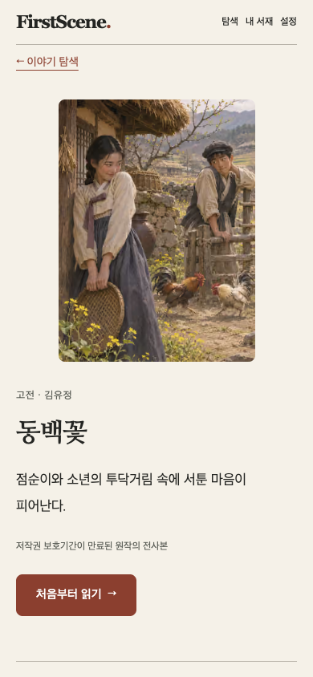

# FirstScene 구현 사례

## 2026-11-28 고도화 검증

### 저장 응답을 받지 못한 경우

브라우저가 보낸 설정 요청을 실제 API와 PostgreSQL에 전달한 뒤, 브라우저로 돌아가는 응답만 끊었습니다. 브라우저에는 저장 확인이 표시되지 않았고, 같은 요청을 재시도하자 보관된 응답이 돌아왔습니다. PostgreSQL의 설정 revision은 한 번 증가했고 해당 요청의 영수증은 한 건이었습니다. Chromium과 Linux WebKit에서 확인했습니다. [읽기 상태 계약과 검증 PR](https://github.com/CodingBot000/FirstScene-Cinematic-Reading-Platform/pull/28)

로컬 프록시 뒤의 앱 두 인스턴스에서도 A가 저장한 요청을 B가 재시도했습니다. A의 트랜잭션은 `committed`, B는 `replayed`였고, 요청별 응답 헤더와 서버 로그를 각각 대응시켰습니다. 확인한 로그 7건에서 세션 쿠키·쓰기 식별자·DB 연결 정보 노출은 0건이었습니다. [요청 상관관계 PR](https://github.com/CodingBot000/FirstScene-Cinematic-Reading-Platform/pull/30)

### 이미지와 리더가 사용하는 브라우저 작업량

고전 표지 20편을 카드·작품 소개·리더의 표시 크기에 맞춰 AVIF와 WebP로 제공합니다. 390×844, DPR 1, CPU 4배 제한, 네트워크 지연 150ms에서 버전별 5회 콜드 탐색을 비교했습니다. 「동백꽃」 작품 소개의 LCP 중앙값은 1,756ms에서 724ms, 탐색 초기 전송량은 778,564바이트에서 333,445바이트로 줄었습니다. 홈의 LCP 중앙값은 768ms에서 784ms로 관찰됐습니다. 이 수치는 Chromium 로컬 실험입니다. [고전 표지 PR](https://github.com/CodingBot000/FirstScene-Cinematic-Reading-Platform/pull/26) · [PR CI](https://github.com/CodingBot000/FirstScene-Cinematic-Reading-Platform/actions/runs/46061914855)

서버 ACK 구간을 추적해 진도 응답 5회에서 5번, 북마크 응답 5회에서 18번 발생하던 리더 렌더를 각각 0번으로 줄였습니다. 아트워크 프레임도 화면 밖에서 계속 잡혀 있던 예약 1건을 0건으로 줄였고, 숨김·복귀 20회에서 복귀 시 하나의 루프를 확인했습니다. 브라우저 설정에서 실제 탭 배율을 200%와 400%로 올려 키보드로 탐색·소개·본문을 열고 설정을 닫은 뒤 초점 복귀를 확인했습니다. [리더 렌더링 PR](https://github.com/CodingBot000/FirstScene-Cinematic-Reading-Platform/pull/27) · [WebGL 수명 주기 PR](https://github.com/CodingBot000/FirstScene-Cinematic-Reading-Platform/pull/29)

### 빌드와 복구를 확인하는 방법

OpenAPI·스토리 스키마에서 파생한 타입이 오래되면 패키지 빌드가 실패합니다. 금지된 패키지 진입점과 오래된 생성 타입을 개별 시험용 작업 트리에 넣었을 때 각 게이트는 실패했고, 원복하면 통과했습니다. 같은 브라우저 환경을 사용하도록 검증한 WebKit 이미지의 ID를 실행에 고정했습니다. [계약 게이트 PR](https://github.com/CodingBot000/FirstScene-Cinematic-Reading-Platform/pull/31)

격리 PostgreSQL 17.12에서 합성 세션과 설정을 백업하고 빈 DB에 복원했습니다. 7개 테이블의 행 해시가 일치했고, 새 앱 프로세스의 조회가 복원된 설정을 반환했습니다. DB 연결을 일시 차단했을 때 readiness는 503, 공개 리더는 200을 반환했습니다. 2026-11-28의 공개 데모에서는 HTTPS 홈·탐색·고전 소개·본문·두 상태 엔드포인트를 읽기 전용으로 확인했습니다. 운영 롤백, 실물 모바일 기기, 사람 사용성 평가의 증거는 아직 없습니다. [공개 데모](https://firstscene-one.vercel.app) · [운영 가이드](runbook.md)

사용자는 제품 범위, 비용과 운영 변경의 승인 경계를 결정했습니다. 에이전트는 작업 브랜치의 구현·테스트·실험과 이 기록을 작성했습니다. 위 기능 변경은 연결된 PR에서 리뷰할 수 있으며, 병합과 운영 검증은 별도로 추적합니다.

## 초기 구현

FirstScene은 문장 읽기를 중심으로 장면의 분위기를 보조하는 웹 제품입니다. 에디터·CMS·게임·챗봇으로 범위를 넓히지 않고, 완결 단편2편과12씬·72문단에 집중했습니다. Next.js·React·TypeScript와GSAP을 사용하고, 공유 UI·원고 계약·리더 상태·React 렌더러·서버 데이터의 패키지 경계를 분리했습니다.

## 읽기와 데이터의 경계

공개 원고는 빌드된 구조화 데이터로 서버 렌더링하므로 JavaScript나DB 연결이 없어도 읽을 수 있습니다. 임의HTML/MDX와 안전하지 않은 링크·YAML은 컴파일 단계에서 거부합니다. 연출 모드의GSAP은 필요할 때 불러오며 일반 읽기와 OS reduced-motion에서는 정적인 본문을 제공합니다. 시스템 글꼴을 사용합니다.

저장 기능은 브라우저별32바이트 opaque HttpOnlycookie와 PostgreSQL의 hash-only 세션을 사용합니다. 쿠키 값이나 내부 세션ID를 API 응답에 넣지 않습니다. 변경은 revision CAS와 멱등성 receipt로 처리하며, 진도의 최댓값과 명시적 완독 기록을 서버에서 보존합니다. 클라이언트는 용량이 제한된 오프라인 큐와 epoch를 사용해 삭제된 세션의 변경이 새 세션으로 섞이는 것을 막습니다.

## 관찰한 결함과 수정

실제 브라우저 검수에서 다음 문제를 재현하고 동일 동작으로 다시 확인했습니다.

- 다른 탭에서 삭제를 시작하자 서버 응답 전에 삭제 완료로 보이던 문제: pending/failed/confirmed 상태를 구분하고204성공 뒤에만 로컬 기록을 지웁니다. 실패한 삭제는 변경 큐를 유지합니다.
- 설정 변경 직후 페이지를 이동하면 저장 의도가 유실되던 문제: 불변의 설정 의도와 세션 epoch를 동기적으로 묶어 탐색 전에 기록합니다.
- 모바일 설정 버튼의 focus outline이 저장 상태 문구와 겹치던 문제: toolbar 간격을 수정하고320/390px 및 두 엔진의 키보드·가림 검사를 추가했습니다.
- 서재의3%진도가 가득 찬 막대로 표시되던 문제: 공용 컴포넌트의0..1기본 계약을 유지하고 퍼센트 호출부에max100을 전달했습니다. 수정 전 실제 native progress position이1로 나타나는 실패와 수정 후 수치 일치를 보존했습니다.
- Next 초기화 hook의 예외가 프로세스를 종료하지 않고HTTP500서버를 유지하던 문제: 안전한 오류 코드로 명시 종료합니다. 잘못된 설정4종과 DB 중단 중 공개 본문 제공을 실제 서버로 검증했습니다.

## 증거와 남은 한계

16개 공개 이미지는 실제 내장 이미지 생성 결과를 가져와 에이전트가 열어 확인했습니다. 캐릭터 기준·표지·배경 순서와 원본hash를 기록하고 AVIF/WebP로 최적화했습니다. 도구가 정확한 생성 모델을 노출하지 않은 항목은unknown입니다. 별도 유료 API 사용액은0USD입니다.

104개 화면 검수와 Chromium·WebKit 자동 검사를 수행했으며, UI를 외부React/Vite 소비 프로젝트에tarball로 설치했습니다. 성능 검사는3회 cold lab navigation과 상호작용·GSAP 해제 검증을 포함합니다. 이 수치는 현장 사용자의 성과나 실물iPhone 검증이 아닙니다. 실제 사람 평가와 인터뷰는0건입니다.

피드백은 사용자 승인에 따라 세션·작품별 한국 시간 자정 기준 하루5회입니다. 세션 잠금 뒤의 DB시각으로 경계를 계산하며 같은 요청의 재전송은 추가 횟수를 소비하지 않습니다. 실제200%브라우저 확대·설정과 피드백의 키보드 조작을 확인하고100%로 복원했습니다. macOS Chromium과 digest고정Linux WebKit을 사용했으며 OS별 글꼴 차이도 새로 열어 검수했습니다. 관리형 보안 스캔은 소스를 검토하고 한 가지 문제를 확인했으나 같은 발견사항의 ID가 중복되어 최종 확정하지 못했습니다. 세션 발급의 공유 한도 문제는 요청 네트워크별 제한과 신뢰할 수 있는 ingress의 명시적 설정으로 수정하고 별도 단위·실제DB·HTTP검사를 수행했습니다. 원래 소스 검수 결과는 수정 전 revision에 묶인 채 확정 대기 상태로 보존합니다. 이 검수 이후 2026-11-27에 PR #23의 병합 커밋을 기존 운영 대상에 배포하고 탐색·읽기·DB readiness를 확인했습니다. 자동 보안 음성 테스트를 관리형 소스 감사의 완료로 표시하지 않습니다. 로컬/공개 제품 완료 상태는 모두 미선언입니다. [릴리스 보고서](../../RELEASE_REPORT.md)
